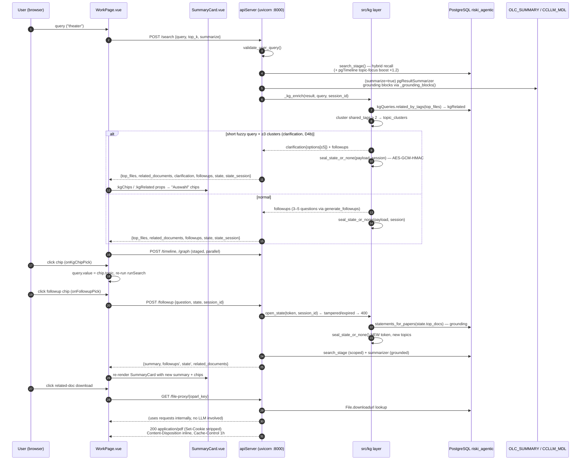
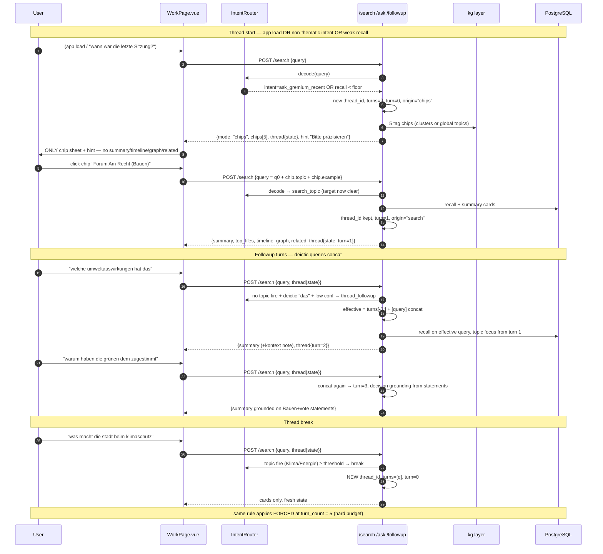

# kg-app-integration — Frontend ⇄ Backend interaction & test coverage

*Review diagram, 2026-11-20. Points at the open issues from the current run.*
*Related files: `app/src/components/WorkPage.vue` (UI), `app/src/components/SummaryCard.vue`,
`FollowupChips.vue`, `RelatedDocsList.vue`, `src/apiServer.py` (endpoints), `src/kg/*`, `scripts/test_kg_api.py`.*

## 1. Interaction diagram (mermaid)



## 1b. v2 — Query threads with followup intent (D7/D8, proposed)



**State / routing rules (summary)**

| Signal | Decision | Effective query | Thread |
|---|---|---|---|
| app load | chips (forced) | — | new, origin=chips |
| non-thematic intent (`ask_gremium_recent`, decision-date, …) | chips | — | new |
| `search_topic` + recall < confidence floor | chips | — | new |
| chip pick | normal cards | `q0 + chip.topic + chip.example` | kept, turn=1 |
| deictic / no-topic-fire / router-conf < floor | `thread_followup` | `turns[-3:] + [q]` concat | kept, turn++ |
| clear target (topic ≥ threshold or slots filled) | break | q only | new, turn=0 |
| turn_count = 5 | forced break | q only | new + notice |

## 2. Data flow per stage

| Stage | Frontend | Backend | kg artefacts | Possible failure (open) |
|---|---|---|---|---|
| 1 recall | `runSearch()` → `apiAsk`/`apiSearch` | `/search` or `/ask` → `search_stage` | `related_by_tags(top_files)` via `kg_pair_links` | distance normalization; empty `related_documents` silently swallowed |
| 2 budget | — | `_run_summarizer` inline | `statements_for_papers(paper_sids)` when grounding | LLM latency / partial block misses |
| 3 clarify | `kgChips` from `clarification.options` | `_kg_enrich` (short-fuzzy + ≥3 clusters) | `seal_state` → `state`/`state_session` | chip click → `onKgChipPick` re-runs `runSearch` (no `/followup`); state refresh only via `onFollowupPick` |
| 4 followup | `FollowupChips @pick` | `/followup` opens sealed state, grounded re-run | statements + `generate_followups` | 400 on missing/expired token; user sees generic error |
| 5 download | plain `<a href>` in `RelatedDocsList` | `/file-proxy/{oparlKey}` streams + strips cookies | `File.downloadurl` lookup | 502 when web1.karlsruhe.de unreachable; 405 on HEAD |

## 3. Known open issues (to re-verify after fixes)

| # | Symptom | Root cause (analysis) | Status |
|---|---|---|---|
| 1 | `can't access property "length", _ctx.kgChips is undefined` | `defineProps` in `SummaryCard.vue` lacked `kgChips`/`kgRelated` (edit landed in truncated heredoc). Added with Array defaults. | **fixed** (commit `dc39fd1`) |
| 2 | Vue warn `Component emitted event "pick" but not declared` | `defineEmits` declared only `refine`/`toggle-file`, `pick` was missing | **fixed** (commit `6c1ff1f`) |
| 3 | Cookie warnings on download | third-party F5 cookie from `web1.karlsruhe.de`; now proxied via `/file-proxy` — none of our endpoints emit Set-Cookie | **fixed** (commit `63764ae`) |
| 4 | Chip click does nothing | `onFollowupPick` read `stateToken`/`stateSession` that had never been bound (state only set inside `runSearch` after clarify). Handlers now wired + token passed. | **fixed in code — needs live re-test** |
| 5 | related docs hidden when `summary` empty | `WorkPage` mounts `SummaryCard` only under `v-else-if="summary || summaryLoading"` → clarification pane has no summary yet, so `kgChips`/`kgRelated` never render | **open — decide placement** |
| 6 | `related_documents` never set a `sessionId` | `_kg_enrich` runs before `session_id` is generated; state sealing of `q0`+top_docs works, but `sessionId` in DB only set afterreturn → `/followup` uses client-sent `sessionId`, mismatch risk none (client sends session back) | info-only |

## 4. Test coverage via `scripts/test_kg_api.py`

Run: `uvicorn src.apiServer:app --port 8000` then `/home/agent/bin/python3.14 scripts/test_kg_api.py`
(`--base` for alternate host). Live output on the current build:

```
[PASS] related documents     – /search "staatstheater" → ≥1 row with shared_tags
[PASS] grounded summary      – /search "Schulverpflegung" → non-empty summary
[PASS] followups + state     – /search "Kindergartenplätze" → 3–5 followups, sealed state
[PASS] followup turn         – POST /followup with state; state refreshed
[ manual] rollback KG_APP_INTEGRATION=0 — flag off, endpoints degrade gracefully
```

Per-case checks (assertions from the script):

1. **related documents** — `len(related_documents) ≥ 1 and related_documents[0].shared_tags` non-empty.
2. **grounded summary** — `bool(summary)` (LLM grounding blocks injected via `_grounding_blocks`).
3. **followups + state** — 3 ≤ len(followups) ≤ 5 **and** truthy `state` (sealed AES-GCM token).
4. **followup turn** — 200 + new `state` != None → verifies seal→open→re-seal round trip.

### Gaps in coverage (for the review)

- No test hits the **clarification** branch (`/search` with a short fuzzy query, expecting `clarification.options` + `state`) — the chip UI's primary path is thus only manually exercised.
- No negative tests: expired/tampered `state` → expect 400; missing `session_id` handling.
- No test for `/file-proxy` (200 + `application/pdf` + no `Set-Cookie`).
- No test asserting the rollback path (`KG_APP_INTEGRATION=0`) actually strips `related_documents`/`followups`/`state` fields; only a manual env-var note.
- The followup test re-uses `data` from the **last** CASES iteration; ok today since case 3 also produces a state but is fragile if cases are reordered.
