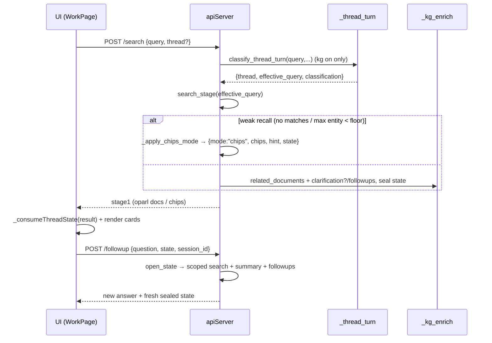

# Request thread (Anfrageverlauf) / follow-up state machinery

> change: `fix-gremium-session-docs-thread` (task 4) — documentation
> deliverable requested as the input for a planned follow-up redesign of
> the context/history logic ("not properly working at the moment" — user,
> 2026-11-25). This file documents the CURRENT behaviour and the issues
> observed; the follow-up change will redesign on top of it.

## Wording (change: fix-gremium-session-docs-thread)

- **Request** — user input (fresh or follow-up); goes into INTENT ROUTING.
- **Search** — the database activity (hybrid recall); follows intent routing.
- **Option selection** — a chip pick transmitted as a structured `option`
  field (`{topic, example?}`), never as typed text: routing treats it as a
  deterministic follow-up (the backend offered the option) via
  `_option_turn` (`src/search/apiServer.py`) — documented rule.

## Components

| Component | File | Role |
|---|---|---|
| Thread turn | `src/search/apiServer.py _thread_turn` | decodes the turn (followup vs new topic), effective query concat, thread bookkeeping |
| Thread classifier | `src/pgIntentRouter.classify_thread_turn` | deictic-marker + intent-model based classification of (followup | new topic | clarification) |
| Thread/turn bookkeeping | `src/kg/kgFollowups.py` | `new_thread`, `advance_thread`, `effective_query`, `THREAD_MAX_TURNS=5` |
| Sealed state token | `src/kg/kgFollowups.seal_state/open_state` | HMAC-style sealed `{q0, thread, top_docs}` blob per `session_id` (`STATE_TOKEN_SECRET`) |
| Chips mode | `apiServer._apply_chips_mode` | weak recall (no hybrid matches or max entity score < `KG_RECALL_FLOOR`) → only chips + hint in payload; card data suppressed |
| Clarification mode | `apiServer._kg_enrich` | short query (≤ 3 words) + multi kg-topic-cluster → `result.clarification.options` (cluster picker chips) + sealed state |
| Followups | `kgFollowups.generate_followups` | 3–5 follow-up questions from the answer summary |
| `/followup` endpoint | `src/search/apiServer.py` | sealed-state follow-up turn: scoped search + summary + fresh follow-ups + fresh token |
| UI | `app/src/components/WorkPage.vue`, `FollowupChips.vue`, `RelatedHintsCard.vue` | body of chip pick / followup pick handlers; `_consumeThreadState` hydrates the state refs |

## Current state machine

```
                    ┌───────────────┐
        new query → │ SEARCH (t+1)  │ track "search": /search | /ask
                    └───┬───────┬───┘
                weak rec│all    │ recall confident
                        ▼       ▼
              ┌────────────┐  ┌──────────────────────────┐
              │ CHIPS MODE │  │ NORMAL MODE              │
              │ chips+hint │  │ thread state sealed (q0, │
              │ only       │  │ top_docs); _kg_enrich:   │
              └────────────┘  │ clarification options on │
                              │ short-fuzzy multi-cluster │
                              └──────────────────────────┘
                        │ user picks chip / followup
                        ▼
              ┌─────────────────────┐
              │ FOLLOWUP (t+k)      │ /followup or amended /search
              │ open_state → answer │ new sealed token
              │ + followups         │
              └─────────────────────┘
        turn_count ≥ 5 → forced_break → new thread (origin="search")
```

## Sequence: query → chips → followup



**Option turns (change: fix-gremium-session-docs-thread)**: chip picks
travel as structured `option` selections (`_option_turn` in apiServer) —
deterministic follow-ups on the sealed thread, no classification call;
the UI never fabricates text input for a backend-offered option.

**Gremium session requests (same change)**: head-of-chain — the thread
turn is skipped entirely and the response resets the context
(`thread_reset`), the view carries topics + session documents only.

## Observed issues (input for the follow-up redesign)

1. ~~Chip pick flow did not thread~~ — RESOLVED: chip picks travel as `option` selections with deterministic follow-up threading (`_option_turn`). Remaining concern: the text-input follow-up path (`/followup`) still models context as concatenation only. `FollowupChips`' path uses `/followup` with the
   sealed state, two different UXes for similar intents. The user wants one
   "refine/context" sequence.
2. **Double `_consumeThreadState(result)`** in the followup handler
   (`app/src/components/WorkPage.vue` ~L268) — harmless duplication, but a
   code smell; the state vars are also held twice (`threadState`/
   `stateToken` pairs).
3. **`effective_query` concatenation** appends the raw followup text to
   `q0`; multi-turn can produce long frankenstein queries that harm
   recall more than they help (measured? no — flagged for analysis).
4. **Clarification vs followups mutual exclusion** is implicit in
   `_kg_enrich` (`short_fuzzy and multi_cluster`) — hard to reason about;
   the classifier treats intents as point scores without a confidence
   floor for the clarification path.
5. **State tokens are ephemeral** (`STATE_TOKEN_SECRET` unset warning —
   every restart invalidates stored thread state, though `open_state`'.
   failure path silently starts a new thread, which flattens the context
   silently).
6. **`threadTurn` reset UX** ("Neues Thema ⟲" visible from turn ≥ 2) does
   not distinguish forced_break (server-side max turns) from a user reset.

## Fix shipped in this change

- `app/src/api.js followup()` used an undefined `base` (ReferenceError on
  first chip pick: "Follow-up fehlgeschlagen (base is not defined)") — now
  routed through the shared `post()` helper.
- `ask_gremium_recent` scope skips document-less meetings (data artifact:
  OParl meeting rows import before their documents) and interprets German
  month filters with current-year default.


## UI hydration (change: fix-followup-deixis)

The browser app MUST hydrate the thread state after EVERY stage-1 `/ask`
(`_consumeThreadState(result)` in `WorkPage.vue` — threadState/threadSession/
turn count). Without the hydration the next request sends `{fresh:true}` and
the `topic_follow` slot decision never sees the previous query — the
browser-side follow-up silently degrades to a fresh request.
